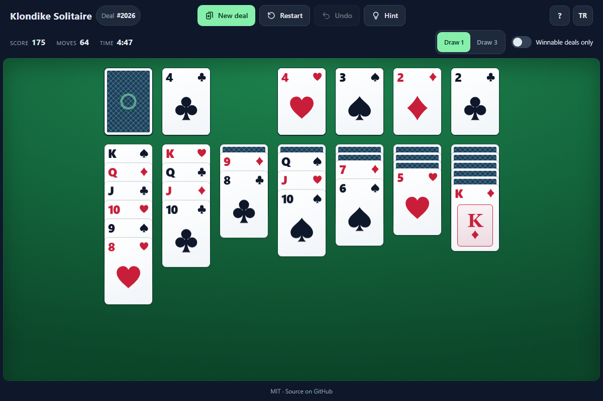

# Klondike Solitaire - the classic patience game in your browser, with numbered deals and a solver that deals only winnable games

[](#tests)
[](LICENSE)

**▶ Play now: https://celaldrg.github.io/solitaire/**



## Features

- Klondike with **Draw 1** or **Draw 3** (a switch applies at once before the first move, otherwise from the next deal or restart), standard scoring, a move
  counter and a timer.
- **Numbered deals** from 1 to 999999: share a deal, replay it by its number or restart it.
- **Winnable deals only**: a built-in solver checks each new deal before you see it, without
  freezing the page. Deals it has won show a check mark.
- **Unlimited undo**, hints that light up a useful move, and **auto-complete** once every card
  is face up.
- Drag and drop single cards or whole runs, tap or double-tap to send a card to its best spot
  (its foundation whenever it can go up), or play with the keyboard.
- Original card design drawn with CSS and SVG, animated dealing and flips, and a cascading
  win celebration (a simple message when you prefer reduced motion).
- English and Turkish. Your language and options are remembered on your device.
- Built for phones as well as desktops. No build step, no dependencies, no network requests.

## How to play

Move all 52 cards to the four foundations, building each suit up from Ace to King. On the seven
tableau piles, build down in alternating colours. Only a King, or a run led by a King, fills an
empty pile. Tap the stock to draw; when it runs out, tap it again to turn the waste over.

Scoring: waste to tableau 5, to a foundation 10, turning a card over 5, foundation back to the
tableau -15.

**Touch and mouse**

| Action | Result |
| --- | --- |
| Tap or click a card | Sends it to its foundation if it can go up, otherwise moves it, with the cards on top of it, to the best pile |
| Drag a card or a run | Drops it on the pile under it, if the move is legal |
| Double-tap or double-click a card | Counts as one tap, so the card that turns up stays put |
| Tap the stock | Draws one or three cards, or turns the waste over |
| Tap the deal number | Plays a deal by its number |

**Keyboard**

| Key | Action |
| --- | --- |
| ← → | Move between piles |
| ↑ ↓ | Take more or fewer cards of a run, or switch rows |
| Space | Pick up the selected cards, then put them down on another pile |
| Enter | Play the best move for the selected cards |
| F | Send to a foundation |
| D | Draw from the stock |
| U, Z, Backspace, Ctrl+Z | Undo |
| H | Hint |
| A | Auto-complete |
| N / R | New deal / restart the deal |
| Esc | Put the picked-up cards back |

## Run locally

The game is plain HTML, CSS and JavaScript modules. Serve the folder with any static server,
for example:

```sh
npx serve .
```

Then open the address it prints. ES modules need `http://`, so opening `index.html` straight
from the file system does not work.

Useful addresses: `?demo` opens a fixed game in progress, and `?deal=123&draw=3` plays deal 123
with Draw 3.

## Tests

```sh
node --test
```

No packages to install. The tests cover the card model, the seeded random number generator,
dealing, move rules and scoring, the stock and Draw 3 recycling, undo, hints, auto-complete,
the solver and the winnable deal search, random play from many deals, the demo game, the
table layout, input rules for touch and keyboard, tap, double-tap and drag gestures, saved
settings, storage and the translations.

## Project structure

```
index.html            page, header, dialogs
style.css             theme, table, cards and animations
src/
  cards.js            cards as numbers 0..51, labels and codes
  rng.js              seeded random number generator and shuffle
  board.js            piles, deals and deal numbers
  rules.js            legal moves and scoring
  assist.js           hints, best move, auto-complete
  solver.js           depth-first solver, winnable deal search
  winnable.js         the same search in small steps for the page
  game.js             game controller: score, moves, timer, undo
  demo.js             the ?demo game in progress
  layout.js           card positions and drop zones for a screen size
  controls.js         input rules: what a press picks up, key map, keyboard cursor
  prefs.js            settings and address options
  storage.js          the only access to localStorage
  i18n.js             English and Turkish strings
  suits.js            suit symbol shapes
  view.js             card elements and their animations
  pointer.js          drag, tap and double-tap gestures
  keyboard.js         keyboard play
  hud.js              header numbers, messages, language switch
  celebrate.js        win animation
  main.js             wires everything together
test/                 node:test suites
docs/screenshot.png
```

## License

MIT. See [LICENSE](LICENSE).

## Türkçe

**▶ Hemen oyna: https://celaldrg.github.io/solitaire/**

Klondike Solitaire, tarayıcıda oynanan klasik tek kişilik kart oyunu. Numaralı eller, ipuçları
ve yalnızca çözülebilir eller dağıtan bir çözücü içerir.

### Özellikler

- **1 kart** ya da **3 kart** çekme (ilk hamleden önce hemen, sonra bir sonraki elde ya da baştan başlatınca geçerli olur), standart puanlama, hamle
  sayacı ve süre.
- 1 ile 999999 arasında **numaralı eller**: bir eli numarasıyla paylaş, yeniden oyna ya da
  baştan başlat.
- **Yalnız çözülebilir eller**: yerleşik çözücü her yeni eli sen görmeden önce dener, sayfa
  donmaz. Çözücünün kazandığı eller onay işaretiyle gösterilir.
- **Sınırsız geri alma**, yararlı bir hamleyi parlatan ipuçları ve bütün kartlar açılınca
  **otomatik bitirme**.
- Tek kartı ya da bütün diziyi sürükleyip bırakma, tek ya da çift dokunuşla en iyi yere
  gönderme (temele çıkabiliyorsa temeline) ve klavyeyle oynama.
- CSS ve SVG ile çizilmiş özgün kart tasarımı, dağıtma ve çevirme animasyonları, kazanınca
  şelale gibi dökülen kartlar (azaltılmış hareket tercihinde yalnızca bir mesaj).
- Türkçe ve İngilizce. Dil ve ayarlar cihazında saklanır.
- Telefonda da masaüstünde de oynanır. Derleme yok, bağımlılık yok, ağ isteği yok.

### Nasıl oynanır

52 kartın hepsini dört temele taşı; her türü As'tan Papaz'a kadar sırayla diz. Yedi sütunda
kartları büyükten küçüğe, renkleri değiştirerek diz. Boş sütuna yalnızca Papaz ya da Papazla
başlayan bir dizi konur. Kart çekmek için desteye dokun; deste bitince açık kartları çevirmek
için yine dokun.

Puan: açık karttan sütuna 5, temele 10, kapalı kartı açmak 5, temelden sütuna -15.

**Dokunmatik ve fare**

| Hareket | Sonuç |
| --- | --- |
| Karta dokun ya da tıkla | Temele çıkabiliyorsa temeline, yoksa üstündeki kartlarla birlikte en iyi sütuna gider |
| Kartı ya da diziyi sürükle | Hamle geçerliyse altındaki sütuna ya da temele bırakılır |
| Karta çift dokun ya da çift tıkla | Tek dokunuş sayılır; altından çıkan kart yerinde kalır |
| Desteye dokun | Bir ya da üç kart çeker, deste bitince açık kartları çevirir |
| El numarasına dokun | Numarasıyla bir el açar |

**Klavye**

| Tuş | İş |
| --- | --- |
| ← → | Sütunlar arasında gez |
| ↑ ↓ | Dizide daha çok ya da daha az kart al, ya da sıra değiştir |
| Boşluk | Seçili kartları al, sonra başka bir sütuna bırak |
| Enter | Seçili kartlar için en iyi hamle |
| F | Temele gönder |
| D | Desteden çek |
| U, Z, Backspace, Ctrl+Z | Geri al |
| H | İpucu |
| A | Otomatik bitir |
| N / R | Yeni el / eli baştan başlat |
| Esc | Alınan kartları geri bırak |

### Yerelde çalıştırma

Klasörü herhangi bir statik sunucuyla aç, örneğin `npx serve .`, sonra yazdığı adrese git.
ES modülleri `http://` ister; `index.html` dosyasını doğrudan açınca oyun çalışmaz. `?demo`
yarıda kalmış sabit bir oyunu, `?deal=123&draw=3` ise 123 numaralı eli 3 kart çekmeyle açar.

### Testler

`node --test` ile çalışır, kurulacak paket yoktur. Kart modeli, tohumlu rastgele sayı üreteci,
dağıtım, hamle kuralları ve puanlama, deste ve 3 kart çekmede açık kartların çevrilmesi, geri
alma, ipuçları, otomatik bitirme, çözücü, çözülebilir el araması, birçok elde rastgele oyun,
demo oyunu, masa yerleşimi, dokunmatik ve klavye kuralları, dokunma, çift dokunma ve sürükleme
hareketleri, ayarlar, depolama ve çeviriler test edilir.

### Lisans

MIT. Ayrıntılar [LICENSE](LICENSE) dosyasında.
